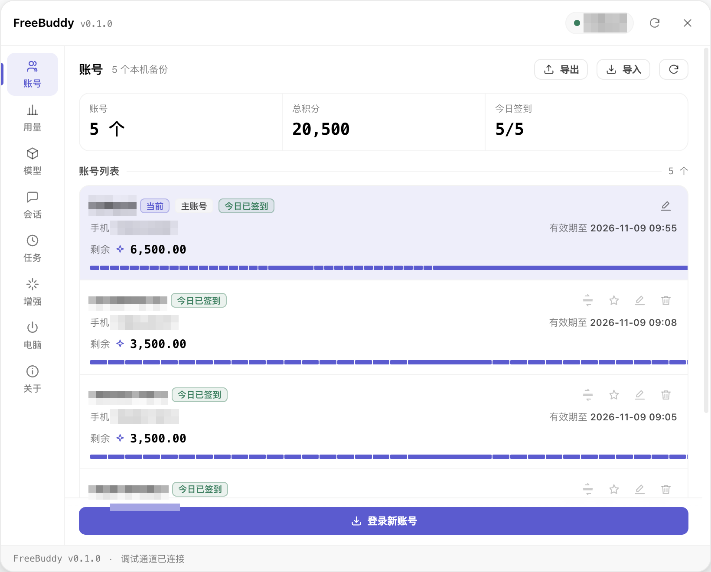
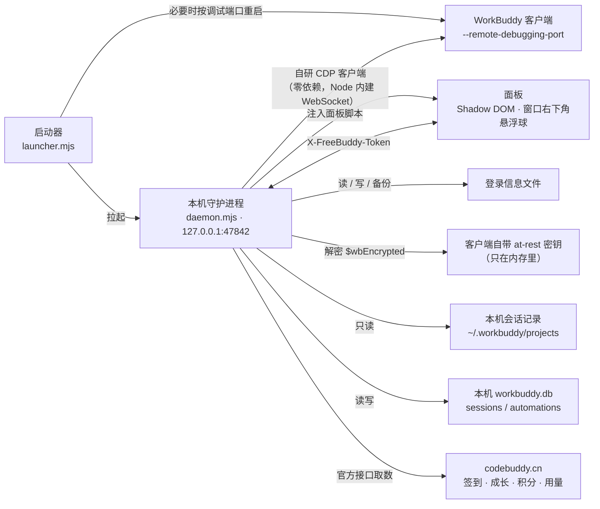
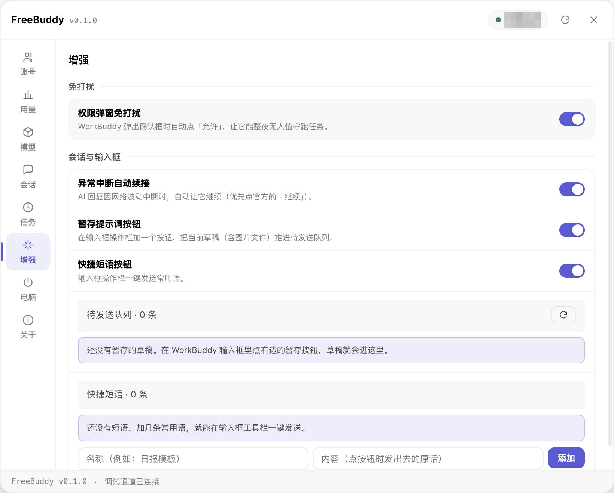

# FreeBuddy

WorkBuddy 桌面端的**本机增强面板** —— 多账号备份与秒切、跨账号积分/签到、Token 用量统计、
模型管理、会话分支与迁移、定时任务、输入框增强、免打扰与休眠控制。



<sub>截图里只把账号名字与手机号打了码，其余（状态徽标、账号数、积分、有效期）全部按原样显示。</sub>

实现方式是**本机回环 CDP 注入**：给 WorkBuddy 多带一个 `--remote-debugging-port` 参数启动，
把一块面板推进它的渲染进程。**不改官方安装包、不改签名、不碰官方云端。**

> 纯本机运行，不收集、不上传任何数据。

**支持 Windows 与 macOS。** 两个平台共用同一套面板与守护逻辑，差异收敛在一层
`src/platform/` 里（进程控制、电源、打开/前台化、开机自启）。

---

## 工作原理



几条核心链路：

- **注入**：守护进程把 `src/panel/` 打包成一段脚本，经 `Runtime.evaluate` 推进 WorkBuddy 的渲染进程，
  面板挂在 Shadow DOM 里，不吃官方样式、也不污染它。
- **秒切**：账号切换 = 写登录文件 + 刷新渲染进程，**约 4 秒**、不重启客户端。
- **自动备份**：守护进程盯着登录态，一变化就落一份，不需要手点。
- **取数**：优先走渲染进程内的官方通道；直连通道用于「非当前账号也能签到/看积分」。

---

## 能做什么

面板一共 8 个页签：

| 页签 | 能力 |
|---|---|
| **账号** | 本机多账号备份与秒切、账户总览、跨账号剩余积分、每日签到状态（按天缓存、非当前账号也能直连签到）、连续登录天数、无感登录新账号、AES-256-GCM + scrypt 加密导入导出 |
| **用量** | 读本机会话记录画 Token 热力图（每日/每周/累计）+ 输入/输出/缓存命中构成 |
| **模型** | 读写官方 `models.json`（保形态、未知字段原样保留、每次写前滚动备份 20 份）、探活、设为默认模型 |
| **会话** | 会话列表与检索、**按消息锚点分支**、迁移到别的账号/工作区、重命名、删除、加密归档导出导入 |
| **任务** | 读写客户端**原生**定时任务表（不另造调度器），任务到点由官方自己起会话执行；5 个模板、立即执行、运行记录 |
| **增强** | **权限弹窗免打扰**（自动点「允许」，可整夜无人值守）、**异常中断自动续接**（回复中断时优先点官方的「继续」，10 分钟最多 5 次、输入框有草稿时不打扰）、**暂存提示词**（草稿进待发送队列，可从面板一键填回输入框）、**快捷短语**（输入框工具栏一键发送常用语） |
| **电脑** | 休眠策略：允许 / 禁止 / 跑完再休眠（改回即释放，不动系统电源计划） |
| **关于** | 版本、数据目录、安全边界 |

### 输入框增强：按钮直接长在 WorkBuddy 的操作栏里


图中框出的两颗就是 FreeBuddy 加的：**暂存提示词**（把当前草稿推进待发送队列再清空输入框）
与**快捷短语**（一键发送常用语）。它们不是浮在页面上的独立窗口，而是插进 WorkBuddy 自己的
输入框工具栏里；React 重渲染把节点冲掉时会自动挂回去。

在面板「增强」页签里开关与维护：



暂存下来的草稿进这里，可以「填回输入框」或删掉；快捷短语也在这里增删（名称 + 内容）。

---

## 运行

**用法就两步**：双击启动脚本 → WorkBuddy 被接管、面板挂上去、窗口顶到前台。

```
Windows    scripts\Start-FreeBuddy.cmd        # 启动并注入
           scripts\Stop-FreeBuddy.cmd         # 摘面板 + 释放唤醒锁 + 停守护进程

macOS      scripts/Start-FreeBuddy.command    # 同上（已 chmod +x，双击即可）
           scripts/Stop-FreeBuddy.command
```

不想用脚本也可以直接跑（两个平台一致）：

```bash
node src/launcher.mjs     # 接管 WorkBuddy + 注入面板
node src/stop.mjs         # 摘掉面板、停守护进程（不关 WorkBuddy）
node src/daemon.mjs       # 只起守护进程（面板由守护进程在页面就绪后自动补种）
```

**本项目零 npm 依赖**，全是 Node 内置模块，所以不需要 `npm install`。
只要 Node ≥ 22.5（`node:sqlite` 用于会话/任务管理）。

启动器干的事：连上（必要时按可执行文件绝对路径精确重启成）带调试端口的 WorkBuddy
→ 拉起守护进程 → 让守护进程注入面板 → 把 WorkBuddy 顶到前台。

## 数据目录

```
Windows   %APPDATA%\FreeBuddy\
macOS     ~/Library/Application Support/FreeBuddy/

accounts\<uid>.info          账号登录备份（官方加密的内容原样保存）
meta.json                    账号备注/排序/主账号
credential-cache.json        能读到明文 token 时另存一份，避免被加密后丢失取数能力
account-data-cache.json      各账号最近一次成功的官方数据（切走后仍能显示）
checkin-cache.json           按天的签到结论
models-backup\               写 models.json 前的滚动备份
settings.json                面板开关与休眠策略
logs\daemon.log              守护日志
```

环境变量：`FB_PROFILE`（`workbuddy-cn` / `workbuddy-ai`）、`FB_DATA_DIR`、
`FB_WORKBUDDY_EXE`、`FB_VERBOSE=1`。

---

## 结构

```
src/config.mjs       档案与本机路径（Windows / macOS 两套）
src/platform/        平台层：index.mjs 选实现；win.mjs 薄转发；mac.mjs 用系统自带命令实现
src/cdplink.mjs      自研 CDP 客户端（零依赖，用 Node 内建 WebSocket）
src/injector.mjs     把面板打包成脚本，经 Runtime.evaluate 注入
src/panel/           面板本体（Shadow DOM；panel.css 定义全部设计 token）
src/daemon.mjs       本地 API + CDP 协调 + 自动备份 + 定时器
src/authstore.mjs    登录文件解析/备份/切换/删除/加密导入导出
src/wbdecrypt.mjs    解密官方静态加密（$wbEncrypted 信封）
src/keytool.cjs      以 ELECTRON_RUN_AS_NODE 跑，向父进程交回 at-rest 密钥
src/official.mjs     官方接口取数（渲染进程通道 + 直连通道）
src/tokens.mjs       本机会话记录的 Token 统计
src/loginflow.mjs    无感登录（auth/state → 浏览器授权 → auth/token → login/account）
src/wbdb.mjs         本机 workbuddy.db 的读写封装（读只读连接；写独立连接 + 事务）
src/sessions.mjs     会话记录文件的纯逻辑（解析/截断/重绑 id）
src/sessionops.mjs   会话的事务性操作：分支、迁移、重命名、删除、加密导出导入
src/models.mjs       模型清单读写（models.json / settings.json，保形态 + 备份）
src/automations.mjs  原生定时任务表的读写与调度计算
src/wbproc.mjs       Windows 进程控制（被 platform/win.mjs 转发，未改一字）
src/power.mjs        Windows 休眠策略（同上）
src/launcher.mjs     启动器；src/stop.mjs 停止器
tools/               真机探针与截图工具（改面板后用它们验收）
docs/MAC-PORT.md     macOS 落地记录（可行性事实、平台层边界、实测结论）
```

---

## 安全边界

- 守护进程**只监听 127.0.0.1**，所有接口要 `X-FreeBuddy-Token`（本机随机 32 字节）。
- 静态加密密钥取自 WorkBuddy 自带的 Electron 绑定，**只在内存里**，不落盘、不进日志。
- `credential-cache.json` 会保存可用的 token（与官方登录文件同等级别的秘密，权限 0600）；
  不需要账号直连取数时可以删掉它，代价是加密账号要切过去才能看数据。
- 面板不收集、不上传任何数据；Token 统计只读本机 `~/.workbuddy/projects` 下的会话记录。
- macOS 上只需要 127.0.0.1 回环 + CDP，**不需要**辅助功能、屏幕录制或完全磁盘访问权限。

---

## 已知边界

- 官方客户端升级后，如果登录文件结构、DOM 锚点或本机数据库列有变动，取数/注入可能需要跟着调整。
  数据库查询已按「想要的列 ∩ 实际存在的列」写，缺列只让那个字段取不到，不会整条失败
  （实测 mac 5.5.6 的 `sessions` 没有 `transport`、`automation_runs` 没有 `failure_code`）。
- 面板统计的是**本机会话记录**，官方 App 里的「使用统计」是账号维度的全量接口数据，两者口径不同。
- 会话「分支」写的是本机记录 + 索引行；官方云端副本不受影响。
- 模型/设置的写入需要客户端重新载入配置或重启才生效（没有文件监听）。
- macOS 上 `caffeinate` 的 `-s` 只在接电时生效；**合盖休眠挡不住**，这是系统规则。
- 首次在 mac 上跑脚本时，系统可能弹一次来源提示——本机自用直接放行即可。
- 「暂存提示词」存的是草稿的**正文与内联图片**。WorkBuddy 里作为**独立附件**挂上的图片文件，
  没法从 DOM 反推回真正的 File 对象，所以填回时只还原正文，附件要手动重新加上
  （暂存时会把该条含几个附件记录一并记下来，面板里能看到）。
- 「异常中断自动续接」靠的是前端可观察的信号（助手消息里的「已取消」指示、错误标记、
  以及官方自己的「继续/重试」按钮）；生成中不动作，输入框里有草稿也不动作。
  10 分钟内最多自动续 5 次，避免在报错页上反复重试。

## License

[AGPL-3.0](LICENSE)

---

<div align="center">
  <p>如果这个工具帮到了你，可以请我喝杯咖啡 ☕</p>
  
</div>
